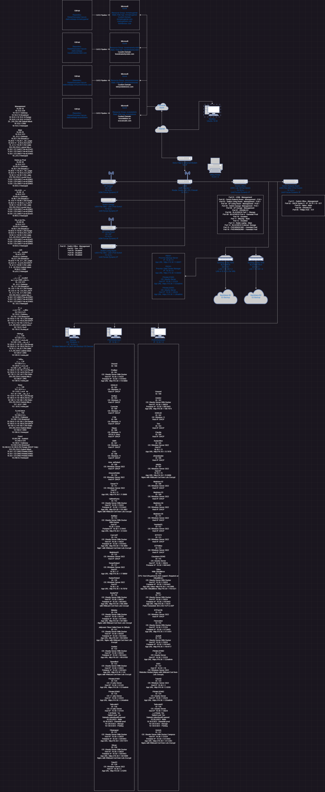

# 🏠 My Homelab 3.0

Welcome To My Homelab 3.0!  
3.0, re-born from the ashes of an accidental password left on a published document that claimed the 2.0 repository. RIP Homelab 2.0, Apr 2026–Oct 2026 
2.0, born from the ashes of an accidental credential leak that claimed the original repository. RIP Homelab 1.0, Aug 2025–Apr 2026 
**Note:** None of the Projects Referenced in this repository is AI-Vibe Coded (as far as I know). If I discover otherwise, it will be labeled as "AI Generated".

---

## 🖥️ Hardware

| Component | Details |
|---|---|
| Virtualization Hosts | 6× Minisforum UM890PRO Pro Mini PCs |
| Misc Server | 1× Dell 1L Mini PC (iMazing) |
| Network | Ubiquiti UniFi |
| Storage | Synology DS1819+ & DS1821+ (2× 8-Bay NAS) |

---

## 🛠️ Software & Infrastructure

| Category | Solution |
|---|---|
| Virtualization | Proxmox |
| Security | Cloudflare + Ubiquiti UniFi IPS |
| VM Backups | Proxmox Backup Server |
| Device Backups | Synology Active Backup for Business |

---

## 💻 Virtual Machines & Containers

- **Ubuntu Server VMs** — Cloud-Init templated, running Docker + Portainer
- **Windows Server 2022** — Rebuilt from Server 2019
- **LXC Containers** — Fully migrated to Ubuntu Server + Docker VMs ✅ *(Completed 02/2026)*

---

## 🏆 Milestones & Accomplishments

| # | Milestone | Date |
|---|---|---|
| 1 | Started documenting Homelab with Draw.IO | 08/2022 |
| 2 | Created VLANs | 12/2022 |
| 3 | Switched subnets from 192.168.x.x to 10.x.x.x | 12/2022 |
| 4 | Started using Cloudflare | 03/2023 |
| 5 | Installed CrowdSec on UniFi hardware | 04/2023 |
| 6 | Started using Backblaze B2/S3 for NAS backups | 04/2023 |
| 7 | Rebuilt Windows 10 VMs to Windows Server 2019 | 05/2023 |
| 8 | Moved domain from Google Domains to Namecheap | 11/2023 |
| 9 | Migrated to new Mini PC hardware | 08/2024 |
| 10 | Switched all Hyper-V hosts to Proxmox; rebuilt all VMs | 08/2024 |
| 11 | Started using LXC containers | 04/2025 |
| 12 | Started documenting Homelab on GitHub | 08/2025 |
| 13 | Rebuilt Windows Server 2019 VMs to Windows Server 2022 | 08/2025 |
| 14 | Reconfigured main switch and reorganized VLANs | 09/2025 |
| 15 | Created first SSH key for Cloud-Init image | 01/2026 |
| 16 | Started using custom Cloud-Init images; began rebuilding LXC containers | 01/2026 |
| 17 | Deployed Family/Friends business websites via Azure Static Web Apps with CI/CD from GitHub | 02/2026 |
| 18 | Implemented wildcard certificate on Nginx via DNS challenge with Cloudflare | 02/2026 |
| 19 | Completed migration of all LXC containers to Ubuntu Server + Docker | 02/2026 |
| 20 | Enabled DNSSEC on Homelab domain via Cloudflare and domain registrar | 03/2026 |
| 21 | Added Authentik SSO Solution | 03/2026 |
| 22 | Configured Authentik to Use LDAP for Jellyfin Media Server and Proxy Forward Auth for Web Based Services | 03/2026 |
| 23 | Configured Authentik to Use OAUTH2 for Immich Photo Server | 04/2026 | 
| 24 | Installed and Configured Fail2Ban on Authentik, Nginx, and Other Nginx/Internet Facing Servers | 05/2026 | 
| 25 | Changed BIOS on All VM Host Hardware to Power back on After a Power Outage. | 05/2026 |
| 26 | Installed and Configured Fail2Ban on all Linux VMs | 05/2026 |
| 27 | Changed Default SSH Port on all Linux VMs | 05/2026 |
| 28 | Hardened Sysctl on all Linux VMs | 05/2026 |
| 29 | Now Calling Scripts From My Github via curl for Linux VMs Instead of Just Copying and Pasting in SSH Terminal | 05/2026 |
| 30 | Setup Ansible + Semaphore for Linux VM Automation and Monitoring. | 05/2026 |
| 31 | Setup WinRM on Windows Server VMs and added to Ansible + Semaphore for VM Automation and Monitoring. | 06/2026 |
| 32 | Migrated to Zone Based Firewall on Unifi and Re-Set Up Custom Rules and VLAN/Zone Isolation | 08/2026 |
| 33 | Disabled Unencrypted WinRM and Basic Authentication on All Windows Server VMs | 11/2026 |
| 34 | Restricted SSH on All Linux VMs, Proxmox Hosts and PBS to the Homelab Network Only (Rolled Out by Ansible With an Automatic Undo if Access Breaks) | 11/2026 |
| 35 | Blocked SSH Logins Over the Remote-Access VPN | 11/2026 |
| 36 | Cut the Fail2Ban Ignore List Down to the Few Admin Hosts That Need It | 11/2026 |
| 37 | Updated the New-VM Setup Script to Apply the Same SSH and Fail2Ban Hardening | 11/2026 |
| 38 | Enabled TOTP MFA on Semaphore | 11/2026 |
| 39 | Confirmed GitHub Secret Scanning and Push Protection on My Repos; Removed My Gmail Address From Public Commit History | 11/2026 |
| 40 | Added Discord Failure Alerts and a 4-Hour Task Timeout to Every Ansible Playbook | 11/2026 |
| 41 | Added a Weekly Pending-Updates Report for the Proxmox Hosts and PBS | 11/2026 |
| 42 | Scheduled Watchtower Container Updates for Quiet Hours, With Discord Notifications | 11/2026 |
| 43 | Staggered Pi-hole and Tailscale Reboots So DNS and Remote Access Never Go Down All at Once | 11/2026 |
| 44 | Built Two-Tier Pi-hole Blocklists (Malware-Only for Everyone, Malware + Ads for Select Machines) and Removed Dead Lists | 11/2026 |
| 45 | Built a Custom Lookalike/Typosquat Domain Blocklist for 34 Brands, Refreshed Monthly by Ansible | 11/2026 |
| 46 | Automated a Daily Pi-hole Blocklist Sync From GitHub, With Validation and Health Checks | 11/2026 |
| 47 | Automated Weekly Pi-hole Updates, One Server at a Time | 11/2026 |
| 48 | Fixed Two Pi-holes Silently Refusing DNS From Other Subnets; Ansible Now Enforces the Setting | 11/2026 |
| 49 | Audited SSH on All Linux VMs: Password Login and Root Password Login Are Off Everywhere | 11/2026 |
| 50 | Turned On SSH Host Key Verification for Ansible (Pinned Host Keys for All 30 Linux Hosts) | 11/2026 |
| 51 | Expanded the Monthly SSH Audit to Proxmox Hosts and PBS, and Made It Fail Instead of Silently Passing | 11/2026 |
| 52 | Turned Off SSH Password Logins on All Proxmox Hosts and PBS (Root by SSH Key Only) | 11/2026 |
| 53 | Replaced the PBS Root Password on All Proxmox Hosts With Per-Host Backup-Only API Tokens | 11/2026 |
| 54 | Added Weekly Backup Verification on PBS and Discord Alerts for Failed Backup Jobs | 11/2026 |
| 55 | Moved Security Issues to a Private Repo and Made the Ansible Repo Private (Read-Only Deploy Key for Semaphore) | 11/2026 |

---

## 📋 To-Do List

- [X] Set up automation Ansible + Semaphore
- [ ] Improve storage architecture — considering tiered storage array
- [ ] Implement full offsite backup strategy (Backblaze currently covers critical data only)
- [X] Sync Pi-Hole instances or implement load balancing ~~(exploring Kubernetes)~~ (Blocklists are now synced by an Ansible Playbook)
- [ ] Set up Home Assistant with dedicated hardware on IoT network
- [ ] Implement Proxmox High Availability / redundant failover once hardware allows
- [X] Add CrowdSec or Fail2Ban on NGINX and Authentik
- [ ] Setup Active Directory for Windows VMs
- [ ] Go From Testing Pi-Hole on a few Machines to Subnet-Wide Enablement
- [X] Change BIOS Settings on VM Hosts to Auto Start After a Power Outage
- [ ] Get Dedicated Hardware for Proxmox Backup Server (Maybe Have 2 of Them for Redundancy?)
- [X] Get SSO Solution (Authentik)
- [X] Give Windows VMs Static IPs (For Ansible)
- [X] Create Schedule/Script to Reboot Windows VMs (Will Use Ansible for this)
- [ ] Research Ceph for Proxmox
---

## ❔ FAQ

Question: Why dont you use Cloudflare Tunnels?
Answer: I have a Video Streaming Service Plus a Photo Hosting Solution that allows Video Uploads, Both of those would Violate the Cloudflare Tunnel TOS. Also I dont want to have some services on the Tunnels and other Services using DDNS. I Decided its either one or the other for all services.

Question: Why dont you use Clustering in Proxmox?
Answer: Ive had the Clustering break in the past when ever updating one the 3 nodes I used to have, so for now no Clustering in proxmox. Maybe in the future if I get enough mini PCs going.

Question: Why do you use mini PCs and not a Racked Server?
Answer: I dont have the physical space in my house or a dedicated room for one plus the noise would keep me up at night.

Question: Why is every docker project you use in its own Linux VM?
Answer: Easier for me to backup and restore using Proxmox Backup Server. Also I dont trust Portainer one day not paywalling how many docker containers you can run in each instance.

Question: Why not Use Ansible to Update the Docker Containers? Why Use Watchtower?
Answer: The Ansible Playbook I was using kept Renaming the Docker Container Image Names to a String of Random Letters and Numbers, Causing the Next Update pass to Fail. Watchtower keeps the Image name intact. (Ansible Now Controls when Watchtower Checks for a new image so I have time to stop it if a Docker Image Repository gets compromised.)

---

## 💻 Tech Stack
AI   
Used to Help With Website CSS  
Also Used to Help Format this Readme  
Also Used to Help Write the Ansible Playbooks and Scripts  

  

CI/CD  
  

Cloud  

  

Code Repository  

  

Education/Reference  

  

Hardware  
  

Framework/OS  

  

Programming Languages  

 
  

---

## 🔗 Projects Used in This Homelab

[View my Projects Used in My Homelab on GitHub »](https://github.com/stars/RobertGonzales1/lists/my-homelab-in-use)  

---

## 🤖 Ansible Automation

All of these run on a schedule (or on demand) from Ansible Semaphore and report to Discord when something needs attention. The playbook repository itself is private, since it describes the internal network.

| Area | Playbook | What it does |
|---|---|---|
| Linux / Docker | Update_Linux_Packages | Weekly OS updates on every Linux VM |
| Linux / Docker | Enforce_Unattended_Upgrades | Keeps automatic security updates switched on |
| Linux / Docker | Check_Memory_Usage, Check_Disk_Space | Hourly resource checks with alerts |
| Linux / Docker | Container_Health_Check | Hourly check that every container is running and healthy |
| Linux / Docker | Watchtower_Schedule | Container auto-updates in a quiet-hours window, with Discord notifications |
| Linux / Docker | Log_Rotation, Journal_Cleanup, Prune_Images | Weekly housekeeping |
| Linux / Docker | Reboot_Age_Report | Flags hosts that need a reboot after updates |
| Security | SSH_Allow_Homelab_Only | SSH only accepted from the homelab network, rolled out with an automatic undo |
| Security | SSH_Collect_Host_Keys | Builds and checks the pinned SSH host keys Ansible trusts |
| Security | SSH_Key_Audit | Monthly audit of SSH password/root login settings and authorized keys on every host |
| Security | Fail2Ban_Status_Check, Fail2Ban_Set_Ignore_IPs | Fail2Ban health and a minimal, consistent ignore list |
| Proxmox / PBS | Proxmox_Host_Health, VM_Resource_Audit | Host health and VM sizing reports |
| Proxmox / PBS | Proxmox_and_PBS_Pending_Updates | Weekly report of pending hypervisor/backup-server updates |
| Proxmox / PBS | PBS_Backup_Verification | Daily check that every VM has a recent backup |
| Proxmox / PBS | PBS_Backup_Tokens | Each hypervisor backs up with its own backup-only API token |
| Proxmox / PBS | PBS_SSH_Keys_Only | Key-only SSH on the hypervisors and backup server |
| Pi-hole | Pihole_Sync_Adlists | Daily sync of each Pi-hole's blocklists from this repo, with validation and health checks |
| Pi-hole | Pihole_Update | Weekly Pi-hole updates, one server at a time |
| Pi-hole | Pihole_Refresh_Lookalike_Domains | Monthly refresh of the custom lookalike/typosquat blocklist |
| Windows | Windows_Update, Windows_Auto_Reboot | Patching and scheduled reboots |
| Windows | Check_Disk_Space, Check_Memory_Usage, Disk_Cleanup | Resource checks and cleanup |
| Windows | Firewall_Check, Admin_Audit, Reboot_Age_Report | Firewall, local admin and reboot reports |

---

## 🗺️ Network Diagram

